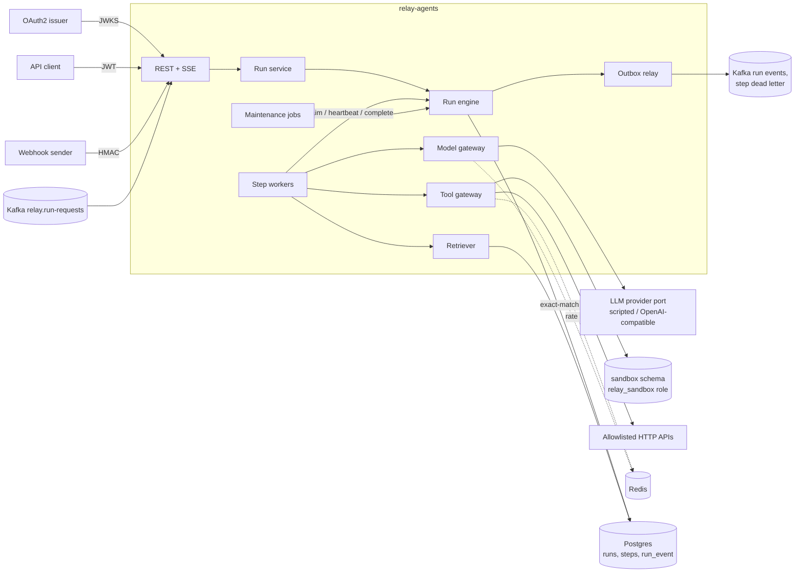

# Relay Agents

A backend for running multi-step LLM agent workflows that survive crashes, can be replayed, and cannot
quietly spend money or call tools they were not given. It is a single Spring Boot service split into
modules, with Postgres (and pgvector) as the source of truth, Redis for rate limits and caching, and
Kafka for events in and out.

I wanted to work through the parts of "agentic" systems that are ordinary backend problems: a worker
dying halfway through a step, a webhook delivered twice, a model loop that never stops calling tools, a
refund that must wait for a human, and being able to answer "what exactly did the agent see and do"
a week later.

It does not talk to a real model by default. There are no paid provider keys behind this project, so
tests and the demo use a scripted provider that returns canned responses deterministically. An
OpenAI-compatible adapter exists (it should work against Ollama's `/v1` endpoint or an OpenAI-style
gateway), but it is only tested against WireMock. See [Known limitations](#known-limitations).

## What it does

- Workflows as a DAG of steps (`AGENT`, `TOOL`, `RETRIEVE`, `BRANCH`, `APPROVAL`) defined in JSON and
  versioned. Steps pass data through templates such as `{{steps.classify.output.intent}}`.
- Agents (system prompt, model, allowed tools, memory window) that run a tool-calling loop.
- A tool registry with JSON schemas for arguments, required scopes per tool, and three kinds of tools:
  built-in Java tools (calculator, refund, ticket), a read-only SQL tool over a sandbox schema, and HTTP
  tools registered per tenant.
- Runs that are durable: every step is claimed with a lease, heartbeated, and fenced, and every model
  call, tool call, retrieval and decision is journaled as an event.
- Replay of a past run, either fully from the recording or with the model called again while write tools
  and approvals still come from the recording, plus a diff against the original.
- Budget guards per run (tokens, cost, tool calls, wall-clock deadline) and per tenant (concurrent runs,
  24-hour cost cap).
- Human approval steps with a separate scope, no self-approval, expiry, and exactly-once execution of
  the approved tool.
- Retrieval over per-tenant knowledge bases: chunking, embeddings in pgvector, Postgres full-text search,
  and hybrid ranking with reciprocal rank fusion.
- Triggers: signed webhooks, cron, and run requests from a Kafka topic, all idempotent.
- Retries with exponential backoff and jitter, per-step timeouts, and a dead-letter topic for steps that
  give up.
- A live event stream for a run over SSE, and a cost report per workflow.

## Architecture



Each module (`workflow`, `agent`, `llm`, `tool`, `rag`, `run`, `trigger`, `secret`, `outbox`) has `domain`,
`application` and `adapter` packages. The domain has no Spring or JDBC imports, adapters depend on
application ports and not the other way round, and modules only reach each other through application
classes. ArchUnit checks all of this in `ArchitectureTest`.

### A run, step by step

1. `POST /v1/workflows/{id}/runs` with an `Idempotency-Key`. The service checks the tenant's quotas,
   inserts the run and its steps, marks steps with no dependencies `READY`, and appends `RUN_STARTED`.
   The same key with the same body returns the first run; with a different body it is a 422.
2. A worker claims one ready step with `FOR UPDATE SKIP LOCKED`, sets a lease and bumps the attempt.
   The claim returns a fence: run, step, worker id and attempt.
3. While the step runs, the worker renews the lease every third of its length. If a renewal fails, the
   worker cancels its own work.
4. Model and tool calls go through gateways that check budgets and policies first and journal the request
   and the result as events.
5. The worker hands the outcome back with its fence. If the step is no longer held by that fence (the
   lease expired and someone else took over, or the run was cancelled), the outcome is dropped.
6. On success the engine stores the output, readies dependants whose inputs are now complete, and moves
   the run to `SUCCEEDED` when nothing is left. On a retriable failure it schedules another attempt with
   backoff. When attempts run out the step and run fail and a `STEP_DEAD_LETTERED` message goes to the
   outbox.
7. A reaper looks for expired leases and treats them as a failed attempt. Other jobs enforce run deadlines
   and expire approvals that nobody acted on.

All of this is in one transaction per transition, with the run row locked, so the step tables and the
event log never disagree. `ReplayIT.eventLogFoldsToTheSameStateAsTheTables` checks that.

### What keeps an agent in its lane

- **Tool scopes.** A workflow can only reference tools that exist, and only if the person saving it holds
  every scope the tool requires. This is checked when the workflow is saved and again when the tool is
  called.
- **Approval.** Tools marked as needing approval, and any write tool called once untrusted content is in
  the step's context (a retrieved document, an HTTP response, or an upstream step that saw either), pause
  the run for a person with `relay.approve` who is not the requester.
- **SQL sandbox.** The SQL tool runs in a read-only transaction as a role that can only `SELECT` from the
  `sandbox` schema, with a statement timeout and row-level security by tenant. A keyword deny list in front
  of it only exists to give the model a clearer error.
- **HTTP tools.** Hosts must be on an allowlist when the tool is registered and when it is called;
  redirects are not followed; responses are size-capped; header values that come from secrets are
  injected at call time and redacted from the journal.
- **Budgets.** Before each model call the gateway reserves the worst case (prompt plus `max_tokens` at the
  model's price) and stops the run with `BUDGET_EXCEEDED` if it would cross the limit. After the call it
  settles the real usage.
- **Rate limits.** A token bucket per tenant per tool in Redis. A throttled call is retried and does not
  count against the run's tool-call budget.
- **PII and injection.** Email addresses, phone numbers and card-like numbers are masked when a document is
  added to a knowledge base. Document text that looks like instructions to the model is flagged.

### Replay

Every non-deterministic input to a run is an event: model responses, tool results, retrieved chunks,
approval decisions. `POST /v1/runs/{id}/replay` starts a new run linked to the source.

- `REPLAY_RECORDED` takes every one of those from the source run, so it costs nothing and should produce
  the same output. It is how you check that a code change did not change behaviour.
- `REPLAY_LIVE` calls the model and read-only tools again but still takes write tools and approvals from
  the recording, so a replay can never issue a second refund.

`GET /v1/runs/{id}/diff` compares a replay with its source step by step.

## Running it

You need Docker with Compose, plus `curl`, `jq` and `openssl` for the demo script.

```bash
docker build -t relay-agents:local .
docker compose up -d
./scripts/demo.sh
```

Compose starts Postgres with pgvector on 55590, Redis on 6540, Kafka, a mock OAuth2 server on 7791, a
WireMock "orders API" on 7792, and the app on 7790. The OAuth server has three clients for the demo:
`dev-asha` (tenant `acme`, read and write), `lead-ravi` (`acme`, read and approve) and `dev-lena`
(tenant `globex`). The secrets in `docker-compose.yml` are dummy values for the demo.

The demo script walks through a support-triage workflow: it creates agents, a knowledge base and the
workflow, answers an order-status question from the sandbox database, sends a refund through approval
(the requester can't approve it, the lead can, a second approval is a 409), replays the refund run from
the recording, calls an HTTP tool that fails once and is retried, starts a run from a signed webhook and
redelivers it, checks that another tenant gets a 404, and prints the cost report. It exits non-zero on
the first check that fails and can be run again on the same stack.

To build and test without Docker Compose (Testcontainers still needs a Docker daemon):

```bash
mvn verify
```

### API

| Method and path | What it does |
| --- | --- |
| `PUT /v1/agents/{name}` | Create or update an agent |
| `POST /v1/workflows`, `POST /v1/workflows/{id}/versions` | Save a workflow or a new version |
| `POST /v1/tools/http`, `GET /v1/tools` | Register an HTTP tool, list tools |
| `POST /v1/kb`, `POST /v1/kb/{id}/documents`, `POST /v1/kb/{id}/search` | Knowledge bases |
| `POST /v1/workflows/{id}/runs` | Start a run (`Idempotency-Key` header) |
| `GET /v1/runs`, `GET /v1/runs/{id}` | List and read runs |
| `GET /v1/runs/{id}/events` | Event log as JSON, or as SSE with `Accept: text/event-stream` |
| `POST /v1/runs/{id}/cancel`, `/resume`, `/replay` | Control a run |
| `GET /v1/runs/{id}/diff` | Compare a replay with its source |
| `GET /v1/approvals`, `POST /v1/runs/{id}/approvals/{stepId}` | Pending approvals and decisions |
| `POST /v1/triggers`, `/disable`, `/enable` | Webhook and cron triggers |
| `POST /v1/hooks/{id}` | Webhook endpoint (`X-Relay-Signature`, `X-Relay-Timestamp`) |
| `GET /v1/costs` | Tokens and cost per workflow for the tenant |

Every endpoint except the webhook needs a JWT with a `tenant` claim and `relay.read`, `relay.write` or
`relay.approve` in `scope`. Errors are RFC 7807 problem details.

## Tests

`mvn verify` runs 54 unit and architecture tests and 25 integration tests. The integration tests use
Testcontainers for Postgres (pgvector), Redis and Kafka, WireMock for HTTP tools, and a mock OAuth2
server for real JWTs.

Some of the ones worth reading:

- `LeaseRecoveryIT`: a step is claimed by a worker that then goes silent. The reaper expires the lease,
  a live worker finishes the step on attempt 2, and when the dead worker finally reports back its outcome
  is rejected by the fence.
- `IdempotencyIT`: concurrent starts with one key create one run; reusing a key for a different body is
  rejected.
- `SupportWorkflowIT`: the refund waits for someone other than the requester and runs exactly once;
  a rejected approval fails the run without calling the tool.
- `BudgetIT`: a run stops before a model call that would overspend, a tool-call limit ends an agent loop,
  and throttled calls do not use up the tool budget.
- `ReplayIT`: a recorded replay reproduces the run without calling tools again, and the event log folds to
  the same state as the tables.
- `WebhookIT`, `KafkaRunRequestIT`: redelivery starts one run; bad or stale signatures are rejected.
- `SecurityIT`: tenant isolation for runs and sandbox rows, read-only tokens, workflows that try to reach
  for secrets or ungranted scopes.
- `RetrievalEvalIT`: recall@3 of hybrid retrieval on a small labelled set has to stay at or above a
  threshold. This is the "eval gate" in CI.

## Measured numbers

Measured on my development box (8 vCPU, 15 GB RAM, shared with other containers), with the compose
stack and the scripted provider. There is no real model in these numbers, so they measure the
orchestration overhead and nothing about LLM latency.

| What | Result |
| --- | --- |
| Order-status run (3 steps, 1 SQL tool call), 50 sequential runs after 10 warm-up runs, server-side start to finish | p50 183 ms, p95 209 ms, max 222 ms |
| 20 runs started concurrently on a quiet stack | all accepted, all finished within 406 ms |
| The same burst repeated straight after | 1.8 to 2.1 s, and one run failed on the SQL tool's rate limit after 3 attempts |
| `mvn verify` (offline, warm Maven cache, Testcontainers images present) | about 23 s |
| `docker compose up` with the image already built, until the app is healthy | about 17 s |

Workers poll for ready steps every 200 ms, which is most of the per-run time above. The failed run in the
second burst is the rate limiter doing its job (20 calls per tenant per tool, refilled at 10 per second),
but it shows that a burst can fail runs rather than just slow them down.

## Design decisions

- **Postgres as the queue.** Steps are claimed with `SKIP LOCKED` from the same database that holds the
  run state, so claiming, completing and journaling are one transaction. Kafka is used for events in and
  out, not for scheduling steps. This caps throughput at what one Postgres can do, which is far beyond
  what LLM-bound runs need.
- **Leases plus fences, not distributed locks.** A worker can always be wrong about whether it still owns
  a step (GC pause, network partition). The fence (worker id plus attempt) makes that safe: the database
  only accepts an outcome from the current holder.
- **Event log next to tables, not event sourcing.** The tables are what the code reads; the event log is
  what replay and auditing read. Writing both in one transaction is simpler than rebuilding state from
  events on every read, and a test checks they agree.
- **Reserve then settle for budgets.** Checking the budget after a call is too late, so the gateway
  reserves the worst case first. The cost is that a run can be stopped a little early.
- **Taint tracking for approvals.** Once a step's context holds text an attacker could control, any write
  tool needs a person. This is cruder than per-value tracking but easy to reason about.
- **Outbox for Kafka.** Run and dead-letter events are written to an outbox table in the same transaction
  and relayed afterwards, so a crash can't lose them or publish events for a rolled-back change.
- **Deterministic provider.** The scripted provider takes rules from the agent definition (a regex on the
  prompt, then a reply or a tool call) and derives token counts from the text. It makes the tests and the demo repeatable and means CI needs no
  keys.

## Differences from the original design

My design notes had a few things I either simplified or left out:

- LLM calls were meant to go through my TokenGate gateway. Here the provider port has a scripted
  implementation and an OpenAI-compatible HTTP adapter that could point at TokenGate or Ollama, but
  neither combination is tested.
- BM25 is Postgres full-text search with `ts_rank_cd`, which ranks similarly but is not BM25.
- No cross-encoder reranker and no semantic cache. The only cache is an exact-match cache in Redis for
  `temperature = 0` calls.
- Workflows are JSON only, not YAML.
- No web UI, no KEDA autoscaling, no Grafana dashboards. Metrics and traces are whatever Spring Boot
  Actuator and Micrometer give by default, with no custom per-step spans.
- Runs start as `RUNNING`; there is no separate `QUEUED` state. Quota checks happen when the run is
  created, and its first steps are `READY` for whichever worker is free.
- No retention job for the run event log. Only published outbox rows are purged (after 7 days).

## Known limitations

- **No real model is tested.** Everything that involves a model runs against the scripted provider. Real
  models will produce malformed tool calls, refuse, or loop in ways the scripts don't cover. The prices
  in the scripted model table are made up, so the cost report is only meaningful as arithmetic.
- **The embedder is not semantic.** The default embedder hashes words into a vector so it works offline.
  It handles queries that share words with the documents. A paraphrase does not work: "my parcel came
  broken, can I get my money back" puts the refund document first with keyword search but not with
  vector search (it ranked third in hybrid). The recall@3 of 1.0 in `RetrievalEvalIT` is on 10 queries over
  8 documents (the gate is 0.8) and says nothing about a real corpus.
- **Rate limits fail open and can fail runs.** If Redis is down, tool calls are not throttled. Under a
  burst, a throttled call is retried with the step's normal retry policy and the run fails if that runs
  out, as in the measurement above.
- **Kafka run requests trust the tenant in the message.** The topic's ACLs are the security boundary. Without
  an idempotency key in the message, partition and offset are used, so the same request published twice
  starts two runs.
- **The HTTP allowlist is by host name.** There is no protection against DNS rebinding, so the allowlist
  should only name hosts you control.
- **The compose stack uses the Postgres superuser for the app.** The sandbox role is separate, but in a
  real deployment the app's own user should not be a superuser either.
- **Webhook bodies are not treated as untrusted.** Taint comes only from tools and retrieval marked as
  untrusted, so a write tool driven directly by a webhook payload does not need approval unless the tool
  itself requires it.
- **PII masking and injection detection are pattern-based**, and masking only applies to knowledge base
  documents, not to run inputs or tool results. They catch the obvious cases. The injection
  heuristic is a tripwire for the event log, not a defence; the real defence is the approval rule for
  tainted runs.
- **HTTP 4xx responses are returned to the model as data** and are not retried. That is deliberate, but it
  means a misconfigured tool fails quietly from the run's point of view.
- **Cron triggers** fire at most once per scheduler tick and are skipped, not queued, when the tenant is
  over quota.
- **The SSE stream polls Postgres** for new events rather than using `LISTEN/NOTIFY`.
- **Two Spring Framework CVEs are ignored in the image scan** (`.trivyignore`): one needs `XsltView` and
  the other needs view fragments over SSE. The app uses neither, and the 6.2.x fixes are not available in
  the open-source line yet. They should be removed when the project moves to Spring Boot 4.
